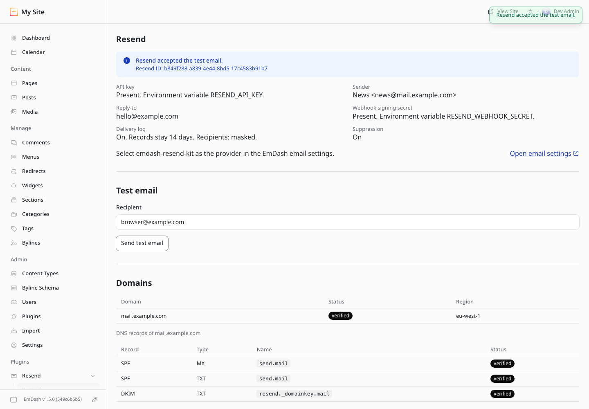
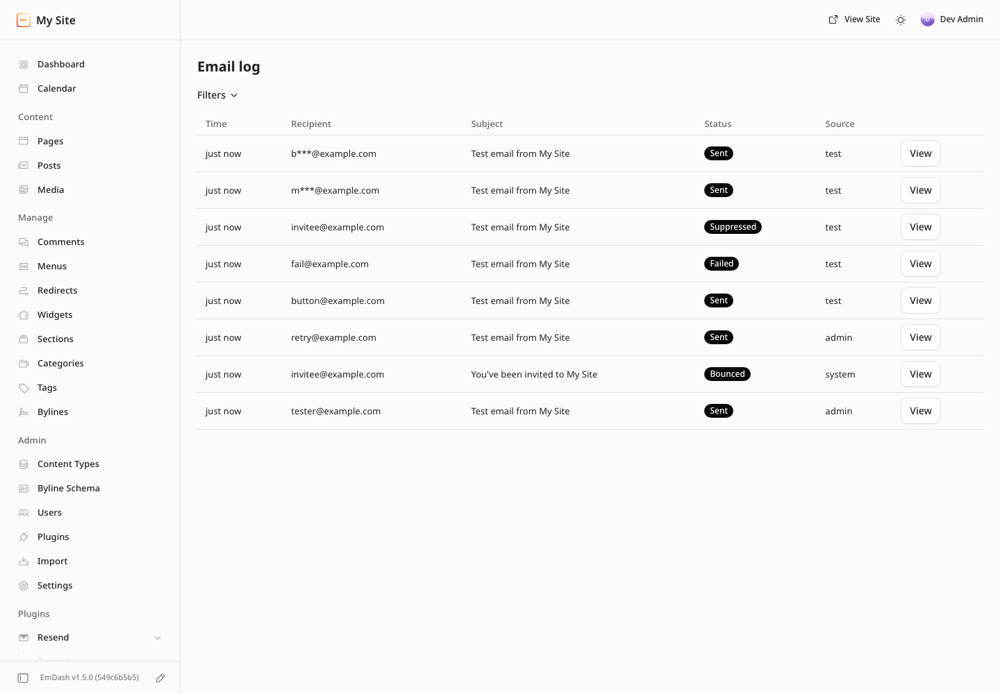
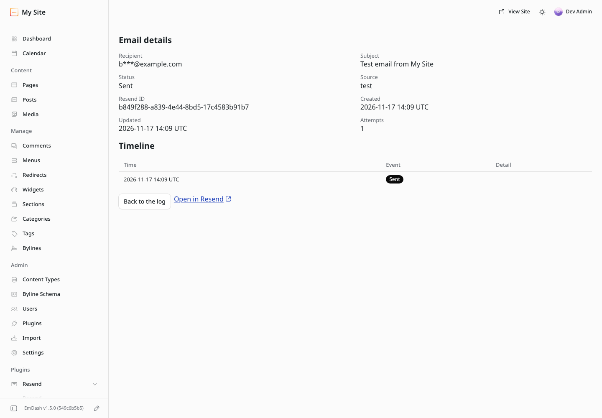
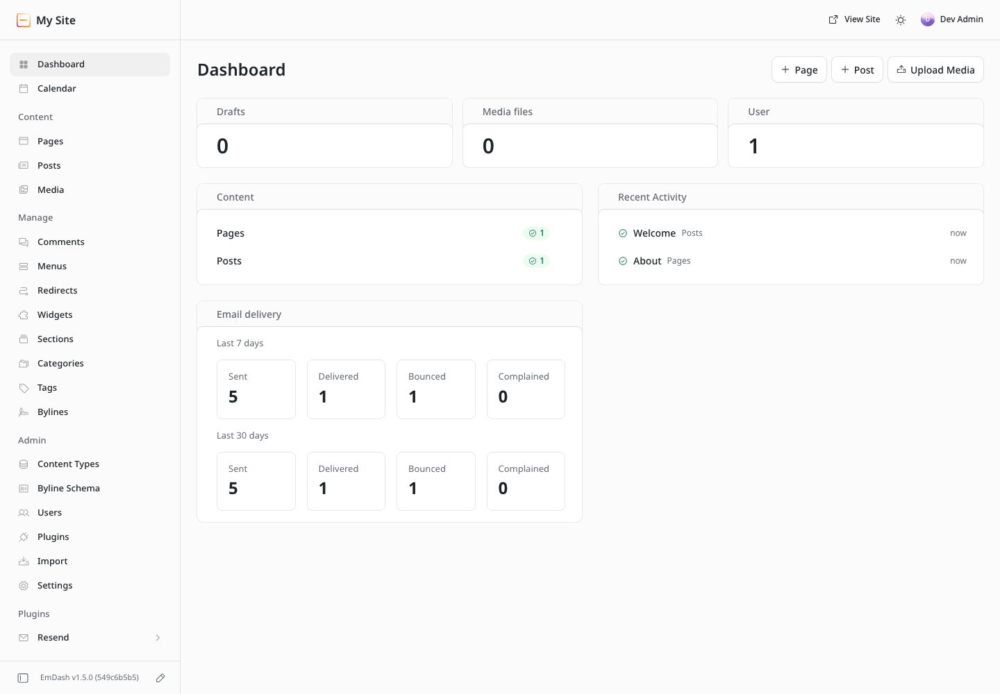

# emdash-resend-kit

[](https://www.npmjs.com/package/emdash-resend-kit)
[](https://github.com/theserverlessdev/emdash-resend-kit/actions/workflows/ci.yml)
[](./LICENSE)

A [Resend](https://resend.com) integration for [EmDash CMS](https://emdashcms.com).

The plugin sends each EmDash email through Resend. It also gives you a delivery log, webhooks, a
suppression list, and a typed client for your site code. It runs on Cloudflare Workers and on Node.

This is an independent project. It has no affiliation with Resend or Cloudflare, and they do not
endorse it.

## Contents

- [Features](#features)
- [Requirements](#requirements)
- [Quick start](#quick-start)
- [Resend setup](#resend-setup)
- [Configuration](#configuration)
- [Secrets](#secrets)
- [Webhooks](#webhooks)
- [Delivery log and privacy](#delivery-log-and-privacy)
- [Suppression list](#suppression-list)
- [Client for site code](#client-for-site-code)
- [Troubleshooting](#troubleshooting)
- [Compatibility](#compatibility)
- [Security](#security)
- [Prior art and credits](#prior-art-and-credits)
- [Roadmap](#roadmap)
- [Contribute](#contribute)
- [License](#license)

## Features

- **Email provider for EmDash.** Invites, magic links, comment notices, and form notifications go
  through Resend.
- **Secrets at runtime.** The plugin reads the API key when it sends an email. The key is never in
  the build output.
- **Reliable sends.** The plugin has a timeout, retries with backoff and jitter, and an idempotency
  key for each message.
- **Clear errors.** Each Resend error becomes one typed error with a plain message.
- **Webhooks.** A public route receives Resend webhooks and verifies the Svix signature.
- **Delivery log.** The admin shows each email with its status and its event timeline.
- **Privacy controls.** You can mask or hash recipient addresses, set the retention time, or turn
  the log off.
- **Suppression list.** The plugin can skip an address that had a hard bounce or a spam complaint.
- **Admin pages.** A settings page, a log page, a suppression page, and a dashboard widget.
- **Client for site code.** A typed, dependency-free client with the full Resend send surface.
- **No runtime dependencies.** The package uses `fetch` and Web Crypto only.



## Requirements

- EmDash 1.5 or later.
- Node 22.16 or later for the build.
- A Resend account with a verified domain.

The plugin is a native EmDash plugin. It runs in the site process. It does not need the Cloudflare
Workers Paid plan. Read [docs/faq.md](./docs/faq.md) for the difference between native plugins and
sandboxed plugins.

## Quick start

### Cloudflare Workers

1. Install the package.

   ```bash
   npm install emdash-resend-kit
   ```

2. Add the plugin to `astro.config.mjs`.

   ```js
   import cloudflare from "@astrojs/cloudflare";
   import react from "@astrojs/react";
   import { d1, r2 } from "@emdash-cms/cloudflare";
   import { defineConfig } from "astro/config";
   import emdash from "emdash/astro";
   import { resendKit } from "emdash-resend-kit";

   export default defineConfig({
     output: "server",
     adapter: cloudflare(),
     integrations: [
       react(),
       emdash({
         database: d1({ binding: "DB", session: "auto" }),
         storage: r2({ binding: "MEDIA" }),
         plugins: [
           resendKit({
             from: "Website <website@mail.example.com>",
           }),
         ],
       }),
     ],
   });
   ```

3. Store the API key as a Worker secret.

   ```bash
   npx wrangler secret put RESEND_API_KEY
   ```

4. Deploy the site.
5. Open the EmDash admin. Go to **Settings**, then **Email**. Make sure that the provider is
   `emdash-resend-kit`.
6. Open **Resend** in the sidebar. Send a test email.

EmDash selects the plugin automatically when it is the only email provider plugin. The provider
list shows the plugin ID `emdash-resend-kit`.

For local development, put the key in `.dev.vars` or in `.env`. Do not commit that file.

```ini
RESEND_API_KEY=re_...
```

### Node

1. Install the package.

   ```bash
   npm install emdash-resend-kit
   ```

2. Add the plugin to `astro.config.mjs`.

   ```js
   import node from "@astrojs/node";
   import react from "@astrojs/react";
   import { defineConfig } from "astro/config";
   import emdash, { local } from "emdash/astro";
   import { sqlite } from "emdash/db";
   import { resendKit } from "emdash-resend-kit";

   export default defineConfig({
     output: "server",
     adapter: node({ mode: "standalone" }),
     integrations: [
       react(),
       emdash({
         database: sqlite({ url: "file:./data.db" }),
         storage: local({ directory: "./uploads", baseUrl: "/_emdash/api/media/file" }),
         plugins: [resendKit({ from: "Website <website@mail.example.com>" })],
       }),
     ],
   });
   ```

3. Set the API key in the environment of the server process.

   ```bash
   export RESEND_API_KEY=re_...
   ```

4. Start the site. Open **Settings**, then **Email**, and make sure that the provider is
   `emdash-resend-kit`. Then open **Resend** in the sidebar and send a test email.

A complete Node site is in [examples/basic](./examples/basic).

## Resend setup

1. Create a Resend account at <https://resend.com>.
2. Open **Domains** and add a domain.
3. Add the DNS records that Resend shows to your DNS provider.
4. Wait until Resend shows the status **verified**.
5. Create an API key at <https://resend.com/api-keys>.
6. Use a sender address on the verified domain, for example `website@mail.example.com`.

### Use a subdomain

Use a subdomain such as `mail.example.com` for the sender domain. Do not use the root domain.

- The reputation of the subdomain is separate from the reputation of the root domain. A problem
  with website email does not damage the email of your team.
- The SPF and MX records of the subdomain do not change the records of the root domain. Your
  mailbox provider continues to work.
- You can use a second subdomain for marketing email later.

### API key permissions

A key with **Sending access** is sufficient to send email. The settings page also shows the domain
status. That function needs a key with **Full access**. With a sending key, the page shows this
message:

```text
This Resend API key can only send email. This action needs a key with full access.
```

Sends continue to work in that case.

## Configuration

### Plugin options

Set the options in `astro.config.mjs`. Each option is optional.

EmDash writes the plugin options into the server bundle. For that reason the options never contain
a secret. The plugin stops the build when it finds a secret in the options.

| Option                     | Type                                | Default                  | Description                                                                         |
| -------------------------- | ----------------------------------- | ------------------------ | ----------------------------------------------------------------------------------- |
| `from`                     | `string` or `{ email, name }`       | none                     | Default sender. The address must be on a verified domain.                           |
| `replyTo`                  | `string`                            | none                     | Default reply-to address. A reply-to on the message has priority.                   |
| `apiKeyEnv`                | `string`                            | `RESEND_API_KEY`         | Name of the environment variable with the API key.                                  |
| `webhookSecretEnv`         | `string`                            | `RESEND_WEBHOOK_SECRET`  | Name of the environment variable with the webhook signing secret.                   |
| `baseUrl`                  | `string`                            | `https://api.resend.com` | Base URL of the API. Use it for a public HTTPS proxy, or for a local mock in tests. |
| `tags`                     | `Record<string, string>`            | `{}`                     | Tags for each email.                                                                |
| `headers`                  | `Record<string, string>`            | `{}`                     | Custom headers for each email.                                                      |
| `sourceTag`                | `string` or `false`                 | `emdash_source`          | Name of the tag with the EmDash source of the email. `false` sends no such tag.     |
| `timeoutMs`                | `number`                            | `10000`                  | Timeout of one HTTP attempt.                                                        |
| `maxRetries`               | `number`                            | `2`                      | Number of retries after the first attempt.                                          |
| `idempotencyWindowSeconds` | `number`                            | `60`                     | Length of the idempotency time window. `0` gives a random key for each send.        |
| `logging`                  | `boolean`                           | `true`                   | Record each send in the delivery log.                                               |
| `recipientPrivacy`         | `"full"`, `"masked"`, or `"hashed"` | `"full"`                 | How the log stores a recipient address.                                             |
| `retentionDays`            | `number`                            | `30`                     | Number of days that the log keeps a record.                                         |
| `suppression`              | `boolean`                           | `false`                  | Skip an address that had a hard bounce or a spam complaint.                         |
| `webhookToleranceSeconds`  | `number`                            | `300`                    | Limit for the age of a webhook.                                                     |

Resend has one API base URL for all regions. You select the region when you add the domain in
Resend. You do not need `baseUrl` for the EU region.

### Admin settings

An administrator can change these values on the **Resend** page of the admin. A value in the admin
replaces the same option in `astro.config.mjs`.

| Setting                | Replaces option    |
| ---------------------- | ------------------ |
| Sender address         | `from`             |
| Sender name            | `from`             |
| Reply-to address       | `replyTo`          |
| API key                | none (secret)      |
| Webhook signing secret | none (secret)      |
| Record emails          | `logging`          |
| Recipient in the log   | `recipientPrivacy` |
| Days to keep records   | `retentionDays`    |
| Skip bounced addresses | `suppression`      |

### Email fields

EmDash 1.5 gives a message these fields: `to`, `cc`, `replyTo`, `subject`, `text`, and `html`. The
plugin sends each of them to Resend. EmDash has no `bcc`, `headers`, or `attachments` fields on a
message. Use the [client](#client-for-site-code) when you need those fields.

## Secrets

The plugin needs two secrets:

- The **API key** sends email.
- The **webhook signing secret** verifies webhooks.

The plugin reads a secret at the time of each request. It looks in these places, in this order:

1. The Cloudflare Worker environment. The plugin reads `env` from `cloudflare:workers`.
2. `process.env`.
3. An encrypted plugin setting that an administrator entered in the admin.

For each secret, the plugin tries these variable names, in this order:

| Secret                 | Variable names                                                                                    |
| ---------------------- | ------------------------------------------------------------------------------------------------- |
| API key                | The name in `apiKeyEnv`, then `RESEND_API_KEY`, then `EMDASH_RESEND_API_KEY`                      |
| Webhook signing secret | The name in `webhookSecretEnv`, then `RESEND_WEBHOOK_SECRET`, then `EMDASH_RESEND_WEBHOOK_SECRET` |

An environment variable has priority over a stored setting. The settings page shows where the
active secret comes from. It never shows the secret.

### Cloudflare Workers

```bash
npx wrangler secret put RESEND_API_KEY
npx wrangler secret put RESEND_WEBHOOK_SECRET
```

For local development, use `.dev.vars` or `.env`:

```ini
RESEND_API_KEY=re_...
RESEND_WEBHOOK_SECRET=whsec_...
```

### Node

Set the variables in the environment of the server process. Use the secret store of your host.

```bash
export RESEND_API_KEY=re_...
export RESEND_WEBHOOK_SECRET=whsec_...
```

### Secrets in the admin

You can also enter the secrets on the **Resend** page of the admin. EmDash encrypts them before it
stores them in the database. EmDash needs the `EMDASH_ENCRYPTION_KEY` variable for that. Without
the encryption key, the page shows an error and stores nothing.

Prefer an environment variable or a Worker secret when you can. A secret in the environment is not
in database backups.

### What not to do

Do not put a secret in `astro.config.mjs`:

```js
// Wrong. The build stops with an error.
resendKit({ apiKey: process.env.RESEND_API_KEY });
```

EmDash serialises the plugin options into the server bundle. On Cloudflare, that bundle is the
Worker script. The plugin rejects the options above with this message:

```text
[emdash-resend-kit] Do not put a secret in the plugin options ("apiKey"). EmDash writes the options into the server bundle. Set the RESEND_API_KEY and RESEND_WEBHOOK_SECRET environment variables, or use "apiKeyEnv" and "webhookSecretEnv" to name other variables.
```

## Webhooks

Webhooks tell the plugin what occurred after Resend accepted an email. Without webhooks, the log
shows `Sent` and `Failed` only.

1. Open the **Resend** page of the EmDash admin. Copy the webhook URL. The URL has this form:

   ```text
   https://your-site.example/_emdash/api/plugins/emdash-resend-kit/webhook
   ```

2. Open **Webhooks** in the Resend dashboard. Add an endpoint with that URL.
3. Select all `email.*` events.
4. Copy the signing secret of the endpoint. It starts with `whsec_`.
5. Store the secret as `RESEND_WEBHOOK_SECRET`. On Cloudflare, use `wrangler secret put`.

The plugin verifies each webhook before it reads the content:

- It computes the HMAC SHA-256 signature with Web Crypto.
- It compares signatures in constant time.
- It accepts a header with more than one signature. A header can hold two signatures after a
  secret rotation.
- It rejects a webhook that is older than 5 minutes.
- It stores the webhook ID, and it ignores a repeat of the same webhook.

The route gives these answers:

| Status | Meaning                                                              |
| ------ | -------------------------------------------------------------------- |
| `200`  | The plugin accepted the webhook.                                     |
| `400`  | A signature header is missing, or the body is not valid.             |
| `401`  | The signature is wrong, or the webhook is too old.                   |
| `405`  | The request method is not `POST`.                                    |
| `503`  | The signing secret is not set. Resend sends the webhook again later. |

The list of events is in [docs/webhook-events.md](./docs/webhook-events.md).

## Delivery log and privacy

The plugin records each send in the storage of the plugin, in your EmDash database.

A record contains:

- The recipient address (`to`).
- The subject.
- The status and the event timeline.
- The Resend email ID.
- The EmDash source of the email, for example `system` or a plugin ID.
- The error message and the number of attempts, when a send failed.
- The time of the send and the time of the last update.

A record never contains the body of the email. That is important, because an invite or a magic
link contains a sign-in token.



The detail view of an email shows the event timeline:



The dashboard widget shows the counts of the last 7 and 30 days:



### Privacy settings

| Setting  | Stored recipient          | Search by address |
| -------- | ------------------------- | ----------------- |
| `full`   | `person@example.com`      | Yes               |
| `masked` | `p***@example.com`        | Yes, full address |
| `hashed` | `sha256:1f3870be274f6c49` | Yes, full address |
| Log off  | No record                 | No                |

In each mode, a record also holds a short SHA-256 hash of the address. The search uses that hash.
A hash is pseudonymous data. It is not anonymous data. Turn the log off when you must store no
recipient data.

The subject stays in clear text in each mode. Do not put personal data in a subject.

### Retention

A daily task deletes each record that is older than `retentionDays`. The default is 30 days. The
task uses the EmDash scheduler, so it needs no extra setup on Workers or on Node.

The dashboard widget uses daily counters. A counter has no recipient data. The plugin keeps the
counters for 90 days.

### Emails from site code

An email that you send with the [client](#client-for-site-code) does not go through the plugin.
The log gets a record for such an email when the first webhook for it arrives. The source of that
record is `external`.

## Suppression list

Set `suppression: true`, or turn on **Skip addresses that bounced or complained** in the admin.

Then the plugin does this:

- A webhook for a permanent bounce adds the recipient to the list.
- A webhook for a spam complaint adds the recipient to the list.
- An event for an email with more than one recipient adds nothing. The event does not say which
  recipient caused it.
- A temporary bounce adds nothing.
- A send to a listed address fails with the error code `suppressed`. The plugin makes no request to
  Resend.
- The plugin removes a listed address from `cc` and sends the email to the other recipients.

The **Suppressions** page of the admin shows the list. An administrator can add an address and
remove an address.

The list needs webhooks. Resend also has its own suppression list at the account level. The two
lists are independent.

## Client for site code

The package exports a client for Astro endpoints, Astro actions, and other server code. The client
has no dependencies. It does not import EmDash.

```ts
import { createResendClient } from "emdash-resend-kit/client";

const resend = createResendClient({
  from: "Website <website@mail.example.com>",
});
```

The client reads `RESEND_API_KEY` at request time, from the Worker environment or from
`process.env`. You can also give the key directly:

```ts
import { env } from "cloudflare:workers";

const resend = createResendClient({ apiKey: env.RESEND_API_KEY });
```

### Contact form endpoint

```ts
// src/pages/api/contact.ts
import type { APIRoute } from "astro";
import { createResendClient, isResendError } from "emdash-resend-kit/client";

export const prerender = false;

const resend = createResendClient({ from: "Website <website@mail.example.com>" });

export const POST: APIRoute = async ({ request, redirect }) => {
  const form = await request.formData();
  const email = String(form.get("email") ?? "").trim();
  const message = String(form.get("message") ?? "").trim();
  if (!email.includes("@") || !message) return redirect("/contact?sent=0", 303);

  try {
    await resend.send({
      to: "hello@example.com",
      replyTo: email,
      subject: "New message from the contact form",
      text: message,
      tags: { category: "contact_form" },
    });
    return redirect("/contact?sent=1", 303);
  } catch (error) {
    console.error(isResendError(error) ? `${error.code}: ${error.message}` : error);
    return redirect("/contact?sent=0", 303);
  }
};
```

Add a spam check, for example Cloudflare Turnstile, to a public form.

### All send options

```ts
const { id } = await resend.send(
  {
    from: { email: "billing@mail.example.com", name: "Billing" },
    to: ["person@example.com", "team@example.com"],
    cc: "accounts@example.com",
    bcc: "archive@example.com",
    replyTo: "support@example.com",
    subject: "Your invoice",
    html: '<p>Your invoice is attached.</p>',
    text: "Your invoice is attached.",
    headers: { "X-Entity-Ref-ID": "invoice-1042" },
    tags: { category: "invoice", customer: "c_1042" },
    attachments: [
      { filename: "invoice.pdf", content: pdfBytes },
      { filename: "terms.pdf", path: "https://example.com/terms.pdf" },
      { filename: "logo.png", content: logoBytes, contentId: "logo" },
    ],
    scheduledAt: new Date(Date.now() + 60 * 60 * 1000),
  },
  { idempotencyKey: "invoice/1042" },
);
```

- `to` accepts 1 to 50 addresses.
- `content` accepts Base64 text, a `Uint8Array`, or an `ArrayBuffer`.
- `scheduledAt` accepts a `Date`, ISO 8601 text, or text such as `in 1 hour`.
- The client creates a random idempotency key when you give none. A retry then cannot send the
  email twice.

### Templates

```ts
await resend.send({
  to: "person@example.com",
  template: { id: "welcome-email", variables: { NAME: "Sam", PLAN: "Pro" } },
});
```

Do not combine `template` with `html` or `text`.

### Batch, get, update, and cancel

```ts
// Send 1 to 100 emails in one request. The batch endpoint accepts no attachments.
const results = await resend.sendBatch([
  { to: "a@example.com", subject: "Hello A", text: "..." },
  { to: "b@example.com", subject: "Hello B", text: "..." },
]);

// Get an email with its last event.
const email = await resend.getEmail(id);
console.log(email.lastEvent);

// Change the time of a scheduled email.
await resend.updateEmail(id, { scheduledAt: "2027-01-05T09:00:00.000Z" });

// Cancel a scheduled email.
await resend.cancelEmail(id);

// Read the domain status. These calls need a key with full access.
const domains = await resend.listDomains();
const domain = await resend.getDomain(domains[0].id);
```

### Client options

| Option             | Default                   | Description                                                       |
| ------------------ | ------------------------- | ----------------------------------------------------------------- |
| `apiKey`           | from the environment      | API key.                                                          |
| `apiKeyEnv`        | `RESEND_API_KEY`          | Name of the environment variable with the API key.                |
| `getApiKey`        | none                      | Function that returns the API key. It has priority over `apiKey`. |
| `baseUrl`          | `https://api.resend.com`  | Base URL of the API.                                              |
| `from`             | none                      | Default sender.                                                   |
| `replyTo`          | none                      | Default reply-to address.                                         |
| `headers`          | none                      | Default headers for each email.                                   |
| `tags`             | none                      | Default tags for each email.                                      |
| `timeoutMs`        | `10000`                   | Timeout of one HTTP attempt.                                      |
| `maxRetries`       | `2`                       | Number of retries after the first attempt.                        |
| `retryBaseDelayMs` | `500`                     | First retry delay.                                                |
| `retryMaxDelayMs`  | `8000`                    | Longest retry delay.                                              |
| `deadlineMs`       | none                      | Time limit for one call with all retries.                         |
| `fetch`            | global `fetch`            | `fetch` implementation.                                           |
| `userAgent`        | `emdash-resend-kit/x.y.z` | `User-Agent` header. Resend rejects a request that has none.      |

### Retries

The client tries a request again in these cases:

- Status `429` with the error `rate_limit_exceeded`.
- Status `409` with the error `concurrent_idempotent_requests`.
- Status `500` and higher.
- A network error.
- A timeout.

The client does not try again for a quota error (`daily_quota_exceeded`, `monthly_quota_exceeded`)
or for a validation error.

The delay doubles after each attempt and has random jitter. The client obeys the `retry-after`
header. When `retry-after` is longer than `retryMaxDelayMs`, the client fails at once.

### Errors

Each failure is a `ResendError`.

```ts
import { isResendError } from "emdash-resend-kit/client";

try {
  await resend.send(email);
} catch (error) {
  if (isResendError(error) && error.code === "rate_limited") {
    // Try again later.
  }
  throw error;
}
```

| `code`                    | Meaning                                                                   | Retry |
| ------------------------- | ------------------------------------------------------------------------- | ----- |
| `missing_api_key`         | No API key is set.                                                        | No    |
| `invalid_api_key`         | Resend does not know the key.                                             | No    |
| `restricted_api_key`      | The key has no permission for the action, or the key is suspended.        | No    |
| `domain_not_verified`     | The sender domain is not verified.                                        | No    |
| `testing_recipients_only` | The account has no verified domain. Resend accepts only your own address. | No    |
| `validation`              | A field of the request is not valid.                                      | No    |
| `invalid_attachment`      | An attachment is not valid.                                               | No    |
| `not_found`               | The email or the domain does not exist.                                   | No    |
| `idempotency_conflict`    | The idempotency key is in use, or its body changed.                       | Some  |
| `rate_limited`            | Too many requests per second.                                             | Yes   |
| `quota_exceeded`          | The daily or monthly quota is used up.                                    | No    |
| `server_error`            | Resend returned status 500 or higher.                                     | Yes   |
| `network_error`           | The request did not reach Resend.                                         | Yes   |
| `timeout`                 | Resend did not answer in time.                                            | Yes   |
| `suppressed`              | The recipient is on the suppression list of the plugin.                   | No    |
| `not_configured`          | The plugin has no API key or no sender.                                   | No    |

An error has these fields: `code`, `message`, `status`, `resendName`, `resendMessage`, `retryable`,
`retryAfter`, and `attempts`. The client removes API keys and signing secrets from each message.

### Verify a webhook in your own route

```ts
import { verifyWebhook, WebhookVerificationError } from "emdash-resend-kit/webhook";

export const POST: APIRoute = async ({ request }) => {
  try {
    const event = await verifyWebhook({
      payload: await request.text(),
      headers: request.headers,
      secret: process.env.RESEND_WEBHOOK_SECRET,
    });
    console.log(event.type, event.data.email_id);
    return new Response(null, { status: 204 });
  } catch (error) {
    if (error instanceof WebhookVerificationError) return new Response(error.code, { status: 401 });
    throw error;
  }
};
```

Give the raw body to `verifyWebhook`. A body that you parsed and serialised again has a different
signature.

## Troubleshooting

### `No email provider is configured.`

EmDash shows this message when it has no selected provider.

1. Open **Settings**, then **Email**, in the admin.
2. Select `emdash-resend-kit` as the provider and save.

### `The Resend API key is missing.`

Full message:

```text
The Resend API key is missing. Set the RESEND_API_KEY environment variable or secret, or enter the key in the Resend settings of the admin.
```

- On Cloudflare, run `npx wrangler secret put RESEND_API_KEY`. Then deploy again.
- On Node, set `RESEND_API_KEY` in the environment of the server process. A value that exists only
  at build time is not sufficient.
- Make sure that the name is correct when you use `apiKeyEnv`.

### `The Resend API key is invalid.`

```text
The Resend API key is invalid. Create a new key at https://resend.com/api-keys and update RESEND_API_KEY.
```

The key does not exist, or someone deleted it. Create a new key and store it again.

### `The sender domain is not verified in Resend.`

```text
The sender domain is not verified in Resend. Verify the domain at https://resend.com/domains. Resend says: The mail.example.com domain is not verified. Please, add and verify your domain.
```

- The domain of the sender address must be the same as a verified domain in Resend.
- `website@example.com` does not match the verified domain `mail.example.com`.
- The **Resend** page of the admin shows the status of each DNS record.

### `Resend accepts only your own address until you verify a domain.`

You use the sender `onboarding@resend.dev`, or your account has no verified domain. Verify a
domain and send from an address on that domain.

### `The sender address is missing.`

```text
The sender address is missing. Set `from` in the plugin options or in the Resend settings of the admin.
```

Set `from` in `astro.config.mjs`, or enter a sender address on the **Resend** page.

### `Resend rate limit reached. Send fewer requests per second.`

Resend allows 10 requests per second for one team by default. The plugin tries again with a delay.
This message appears when the last attempt also fails.

### `The Resend sending quota is used up.`

You reached the daily or monthly quota of your Resend plan. The plugin does not try again.

### `The recipient is on the suppression list (bounced). The plugin did not send the email.`

The address had a hard bounce or a spam complaint. Open **Suppressions** in the admin and remove
the address when it is valid again.

### `Resend did not answer in 10000 ms.`

Resend did not answer before the timeout. The plugin tries again. You can change `timeoutMs`.

### The second test email does not arrive

Two identical messages in the same time window have the same idempotency key. Resend then sends
one email and returns the same ID two times. The window is 60 seconds by default.

- The **Send test email** button of the plugin always sends. Each test has its own key.
- The test button of EmDash in **Settings**, **Email** sends the same text each time. Wait
  60 seconds, or set `idempotencyWindowSeconds: 0`.

### The log shows `Sent` and never `Delivered`

The plugin gets no webhooks.

- Make sure that the webhook URL in Resend is the URL from the **Resend** page.
- Make sure that `RESEND_WEBHOOK_SECRET` contains the signing secret of that endpoint.
- Look at the delivery attempts of the webhook in the Resend dashboard.

### The webhook answers `503`

```text
The webhook signing secret is not set. Set RESEND_WEBHOOK_SECRET.
```

Store the signing secret. Resend sends the webhook again later.

### The webhook answers `401`

```text
The webhook signature does not match the signing secret.
```

- The secret is from a different endpoint. Copy the secret again.
- A proxy changed the body of the request. The plugin needs the raw body.

### `EmDash did not store the secret.`

```text
EmDash did not store the secret. Set EMDASH_ENCRYPTION_KEY, or use the RESEND_API_KEY and RESEND_WEBHOOK_SECRET environment variables.
```

EmDash needs `EMDASH_ENCRYPTION_KEY` to encrypt a secret setting. Run `npx emdash secrets generate`
to create a key, or use environment variables for the Resend secrets.

### The domain table shows an error

```text
This Resend API key can only send email. This action needs a key with full access.
```

The key has **Sending access** only. Sends work. Use a key with **Full access** to see the domain
status.

### The build stops with `Do not put a secret in the plugin options`

Remove `apiKey` from `resendKit({ ... })`. Read [Secrets](#secrets).

## Compatibility

| emdash-resend-kit | EmDash | Astro | Node (build)   | Runtimes                 |
| ----------------- | ------ | ----- | -------------- | ------------------------ |
| 0.1.x             | 1.5.x  | 7.x   | 22.16 or later | Cloudflare Workers, Node |

The tests of this version ran with EmDash 1.5.0. Earlier EmDash versions have a different email
message type and different capability names, and this package does not support them.

## Security

- **No secret in the bundle.** The plugin options contain names of variables, not values. The
  plugin rejects options that contain a secret. An automated check builds a Cloudflare site with a
  marker key in the environment and searches the output for the marker.
- **No secret in logs.** Log lines contain a masked recipient, an error code, and the Resend ID.
  The plugin removes API keys and signing secrets from each error message.
- **No email body in storage.** The log stores no `text` and no `html`.
- **Signed webhooks.** The webhook route is public, and it accepts only a request with a valid
  signature and a recent timestamp.
- **Admin routes need permission.** The admin route needs a signed-in user with the
  `plugins:manage` permission.
- **Fixed API host.** The API host comes from the site configuration only. An administrator cannot
  change it in the admin, so a changed setting cannot send the API key to a different host.
- **Limited network access.** The plugin declares `api.resend.com` as its only allowed host. A
  custom `baseUrl` adds one host.

Report a vulnerability in private. Read [SECURITY.md](./SECURITY.md).

More detail is in [docs/architecture.md](./docs/architecture.md).

## Prior art and credits

- [`emdash-resend`](https://www.npmjs.com/package/emdash-resend) by bison-digital is a small and
  clean Resend provider for EmDash. This project uses the same descriptor pattern, and it started
  from a review of that package. Use `emdash-resend` when you need only a provider.
- The official Cloudflare email plugin in `@emdash-cms/cloudflare` shows how a native provider
  reads the Worker environment at runtime.
- [Resend](https://resend.com) documents its API and its webhooks at <https://resend.com/docs>.
- [Svix](https://docs.svix.com/receiving/verifying-payloads/how-manual) documents the signature
  scheme. The tests use the test vector from that page.

## Roadmap

These Resend features are not in this version:

- Audiences and contacts.
- Broadcasts (marketing email).
- Topics and subscription preferences.
- Inbound email.
- A sandboxed build of the plugin for the EmDash plugin registry.

Open an issue when you need one of them. Describe your use case.

## Contribute

Read [CONTRIBUTING.md](./CONTRIBUTING.md). For questions, read [SUPPORT.md](./SUPPORT.md).

## License

[MIT](./LICENSE). Copyright (c) The Serverless Dev and contributors.
